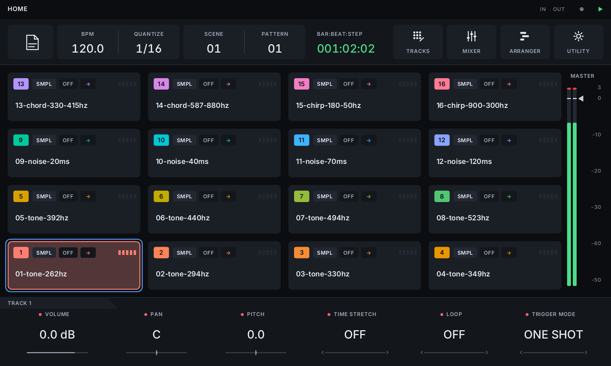

# freesp16

A free, open-source sampler and groovebox app for the Pioneer DJ TORAIZ SP-16. It runs on the instrument from a USB
stick, without flashing or changing anything on the instrument, and on the Linux desktop.



**Website, downloads and user guide: [freesp16.github.io](https://freesp16.github.io)**
([source](https://github.com/freesp16/freesp16.github.io)) · **Chat:** [Discord](https://discord.gg/DedpwtE6EK)

- Sixteen tracks: Sample, Thru (the audio input through the track's effects), MIDI and instrument tracks.
- A step sequencer with parameter locks, retriggers, micro-offsets, swing and real-time recording.
- 16 scenes of 16 patterns, pattern chains and an arranger.
- A mixer with sends, separate outputs, headphone cue and the analog-filter loop.
- Two insert effects per track plus send and master effects (chorus, flanger, phaser, EQ, filter, delay, reverb,
  lo-fi, compressor, distortion, ducker), an LFO per track, sampling and time-stretch.
- Opens the projects and samples made with the instrument's own software.

## How it runs on the instrument: the boot menu

freesp16 does not replace the instrument's software. It is started by the
**[boot menu](https://github.com/freesp16/bootmenu)**, a separate community project: an `autoexec.bin` that the
instrument runs from a USB stick when the stick is plugged in. The boot menu shows the apps it finds on the stick and
the official software, and starts the one you choose.

```
USB stick (FAT32)
├── autoexec.bin       the boot menu (from github.com/freesp16/bootmenu)
├── freesp16           this app: the hardware build, a plain ARM executable
├── freesp16-data/     created by the app: its projects, samples and settings
├── freesp16.conf      optional settings
└── bootmenu.log       written by the boot menu
```

How the two fit together:

- The boot menu lists every compatible executable (32-bit ARM, armel, glibc 2.13 or older) in the stick's root or
  in `apps/`. The file name is the app id, so the hardware build must be named exactly `freesp16`.
- freesp16 carries its name, version and 128 × 128 icon in an ELF note (`.note.appinfo`, generated by
  `tools/gen-app-info.py` from `resources/icons/app-icon.png`), so the menu shows them without running the app.
- When you start it, the menu exits and freesp16 gets the screen, the panel and the audio to itself. Its data
  folder `/root/data` is mapped to `freesp16-data/` on the stick, so nothing is written to the instrument's internal
  memory. The `key=value` lines of `freesp16.conf` on the stick reach the app as `FREESP16_<KEY>` environment
  variables.
- When freesp16 quits, the boot menu comes back. The menu remembers the last app and starts it on its own after a
  short countdown next time.

The app still reads the projects and samples made with the stock software, on the instrument and in a
`PIONEER DJ SAMPLER` folder on any stick.

## Install on the instrument

1. Format a USB stick as **FAT32**.
2. Download `autoexec.bin` from the [boot menu's latest release](https://github.com/freesp16/bootmenu/releases/latest)
   and `freesp16` from [this project's latest release](https://github.com/freesp16/freesp16/releases/latest) (or
   build it, see below: `out/armel/freesp16`).
3. Copy both files to the **root** of the stick. Keep the names exactly `autoexec.bin` and `freesp16`, without an
   extension.
4. Switch the instrument on without the stick and wait for the home screen of the stock software.
5. Plug the stick in. The boot menu appears after a few seconds: turn **SELECT** to choose freesp16, push it to start.

To switch the instrument off, press the **POWER** button on the back, as with the stock software: freesp16 saves its
state, unsaved changes and preferences, flushes the stick and asks the instrument to power down. At the next start
the project reopens where you left it, unsaved changes included (they stay unsaved until you SAVE).

To update freesp16, copy a new `freesp16` over the old one; `freesp16-data/` stays. To go back to the stock software,
choose it in the boot menu, or remove the stick and switch the instrument off and on. The
[installation guide](https://freesp16.github.io/install/hardware/) on the website has screenshots and troubleshooting.

## Plugin presets

Open **PRESETS** on a plugin track or a plugin FX slot. Choose **SAVE PRESET...**, enter a name and press **SAVE**.
The same plugin can recall that sound under **USER** in any project on the stick. Insert, send and master FX
share the same library. Reusing a name asks for confirmation before replacing it.

User presets live in `freesp16-data/freesp16/Presets/Plugins/` on the USB stick. Copy that directory to another stick to
transfer the library. Install the matching plugins on the destination stick. Saving a project embeds its current
plugin settings, so replacing a library preset later leaves saved projects intact.

## Run on the Linux desktop

The same app runs natively on Linux x86-64 in an 800 × 480 window, with ALSA audio (PipeWire and PulseAudio work
through `default`), the computer keyboard laid out like the panel and the mouse as the touch screen. See the
[Linux guide](https://freesp16.github.io/install/linux/) for the key map and settings.

## Build

Requirements: CMake 3.25 or newer, Ninja, Python 3, a C++20 compiler, and Docker for the hardware build. For the
desktop build on Debian / Ubuntu: `libasound2-dev libx11-dev libegl-dev libgles-dev` (and `xvfb` for the headless
checks).

```bash
git clone https://github.com/freesp16/freesp16.git
cd freesp16
git submodule update --init --depth 1                       # JUCE 9.0.6
cmake --preset host-fast && cmake --build --preset host-fast -j8 && ctest --preset host-fast -j8
build/host-fast/bin/freesp16                                # the desktop app
scripts/build-armel.sh                                      # the hardware build -> out/armel/freesp16
scripts/host-smoke.sh                                       # headless end-to-end check (Xvfb, file audio, scripted input)
```

The hardware build runs in a Docker cross toolchain (`toolchain/Dockerfile`: GCC 11, Debian wheezy armel sysroot) and
checks that the binary needs nothing newer than glibc 2.13. `ci/run-local.sh` runs the same stages as CI: lint, host
build and tests, golden audio tests, the ARM build, the glibc check and packaging.

### Desktop settings

Settings are `key=value` lines in `~/.config/freesp16/freesp16.conf`, or environment variables with the `FREESP16_`
prefix (for example `FREESP16_SCALE=2`):

| Setting | Values |
|---|---|
| `render` | `soft` (default on the desktop), `gl-x11` (OpenGL ES 2 through EGL) |
| `scale` | `1` … `4` (1 = 800 × 480) |
| `audio_device` | an ALSA PCM, or `file:<path.wav>` to record the output in real time |
| `input_script` | a file of timed input events (format in `src/io/controllers/ScriptedInput.h`) |
| `screenshot`, `screenshot_frame` | write a PNG of frame N |
| `platform` | `host`: headless, no window, offline audio |

On the desktop, **Ctrl + mouse wheel** plays the touch strip (releasing Ctrl lifts the finger), **F11** is the strip's
MODE and **F12** its HOLD.

## Source layout

| Folder | What's in it |
|---|---|
| `src/core` | data model, parameters, commands, undo |
| `src/engine` | the real-time audio engine: voices, effects, mixer, sequencer, MIDI |
| `src/services` | sample library, projects, import / export, rendering |
| `src/io` | controllers, MIDI devices, scripted input |
| `src/ui` | screens, widgets and the UI framework |
| `src/platform` | everything that knows the machine: `imx6` (the instrument), `linux` (the desktop), `host` (headless), `common` |
| `src/app` | the composition root |
| `tests/` | unit, snapshot, golden audio, benchmark and end-to-end tests |
| `toolchain/`, `cmake/`, `scripts/`, `tools/`, `ci/` | build, packaging and checks |

`src/` is the include root. Modules register themselves, so new screens, effects and controllers don't require
editing shared files; `tools/check-deps.py` and `tools/rt-lint.py` enforce the dependency rules between modules and the
real-time rules of the audio thread. The project's name, display name and id live only in
`cmake/ProjectIdentity.cmake`.

## Contributing

Bug reports, ideas and pull requests are welcome: see [CONTRIBUTING.md](CONTRIBUTING.md), open an
[issue](https://github.com/freesp16/freesp16/issues) or talk to us on [Discord](https://discord.gg/DedpwtE6EK).

## License

The code of this repository is GPL-3.0-or-later ([LICENSE](LICENSE)). It is built with
[JUCE](https://juce.com), which is AGPLv3, so distributed binaries also follow the AGPLv3 for the JUCE part. Fonts
and other components are listed with their licences in [THIRD_PARTY.md](THIRD_PARTY.md).

This is an independent community project. It is not affiliated with or endorsed by Pioneer DJ or AlphaTheta.
TORAIZ and SP-16 are their trademarks, used here only to say which hardware this runs on. No firmware, firmware data
or factory content is included, and nothing is written to the instrument's firmware.
